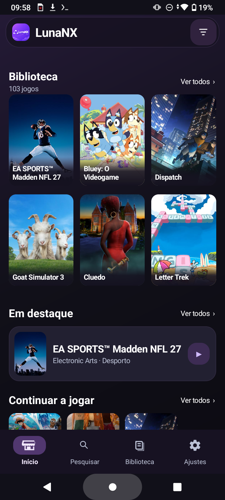
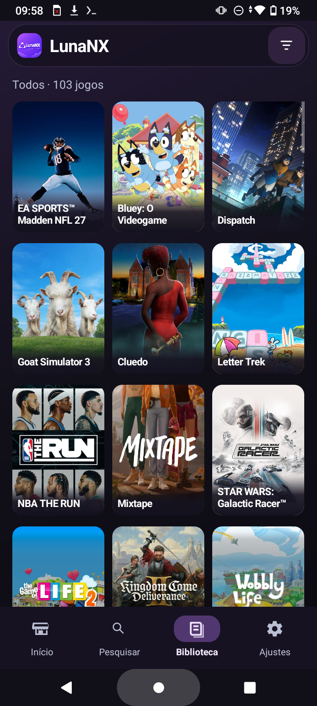
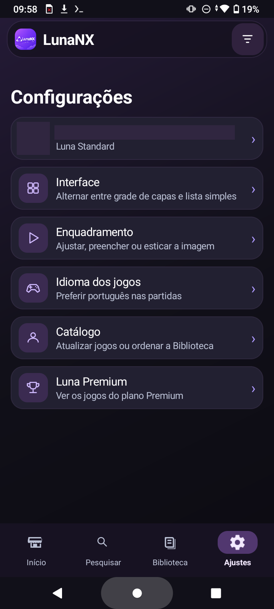

# LunaNX Android

LunaNX Android is an experimental, community-maintained client for Amazon Luna. It brings the original Nintendo Switch project to Android with a searchable game library, fullscreen streaming on the device, Bluetooth and USB gamepad support, and on-screen controls.

<table>
  <tr>
    <th>Home</th>
    <th>Library</th>
    <th>Settings</th>
  </tr>
  <tr>
    <td></td>
    <td></td>
    <td></td>
  </tr>
</table>

## Getting started

You'll need an ARM64 device running Android 9 or later and an Amazon account with access to Luna. The game catalog depends on your account region and plan.

1. [Build and install the Android APK](#build-and-install).
2. Open LunaNX, choose your Amazon account's country, and generate a sign-in code. Enter that code on the Amazon page shown in the app.
3. Browse **Início** (Home) or **Biblioteca** (Library), or use **Pesquisar** (Search). Open a game and select **Jogar** (Play).

When Luna puts a launch in a queue, the waiting screen updates as the server reports your position and estimated wait. Once the stream connects and video starts, the player opens automatically. **Cancelar espera** stops waiting in the app and returns to the library.

To request Brazilian Portuguese for the next game, open **Ajustes → Idioma dos jogos** (Settings → Game language). Available audio and subtitle languages vary by game.

## Set up a streaming profile

Open **Ajustes → Perfis de transmissão** (Settings → Stream profiles) to choose a preset or save your own.

| Preset | Requested resolution | Requested FPS | Bitrate limit |
| --- | ---: | ---: | ---: |
| Economia (Data saver) | 720p | 30 | 5 Mb/s |
| Equilibrado (Balanced, default) | 720p | 60 | 10 Mb/s |
| Qualidade (Quality) | 1080p | 60 | 15 Mb/s |

Choose **Criar perfil** (Create profile) to save a named configuration. Custom profiles offer 720p or 1080p, 30 or 60 FPS, a bitrate limit between 3 and 20 Mb/s, a screen fit mode, and the option to show metrics when play starts. The active profile applies to the next launch. Luna and the connection determine the video the device actually receives.

## Player controls and diagnostics

Double-tap the video or press **Start + Select** on a gamepad to open the player menu. Use it to fit the entire image, fill the screen with cropping, or stretch the image. By default, on-screen controls appear when no physical gamepad is connected. Tap an open area of the video to reveal the player shortcuts, including **Controles** (Controls) when the virtual pad is hidden. The shortcuts hide again after three seconds. The player menu also lets you toggle the virtual pad.

**Mostrar métricas** (Show metrics) displays decoded FPS, bitrate, and RTP jitter during play. Tap the overlay for queue, codec, and recovery counters.

During a session, the app requests a low-latency Wi-Fi lock on Android 10 and later, or a high-performance lock on Android 9. The lock is released when playback ends or fails. Low-latency mode requires the app to be in the foreground with the screen on. Its effect depends on the device and network.

When you leave a game, the session report shows the requested profile, session time, average decoded FPS and bitrate, the share of decoded frames scheduled for the screen, and intervals without decoded video. **Detalhes técnicos** expands the full counters and recent events. **Copiar relatório** copies the full text.

The technical report includes received and decoded frame counts, frames scheduled for display, damaged RTP units, recovered and expired packet gaps, frames discarded while waiting for a keyframe, and decoder resets. The codec delay counter measures input-to-output time inside the local decoding path.

For a playback issue, share the report with your app version, device model, connection type, and what you saw during play. Review the report before sharing and keep Amazon credentials, sign-in codes, and signing keys private.

## Build and install

On Linux, install JDK 17 or later, Python 3.12 or later, CMake, and Ninja. Install Android SDK Platform 35, Android SDK Build Tools, and the Android NDK. Set `ANDROID_SDK_ROOT` and `ANDROID_NDK_HOME` to their installation directories. Check out the `android` branch and run this command from the repository root.

```sh
JOBS=4 sh android/build-apk.sh
```

Open `android/build/LunaNX-Android.apk` on your Android device to install it. The script creates a development signing key on the first build. Android requires the same signing key to install an update over an existing copy.

## Credits and license

**KazaR‑RooT** created LunaNX for Nintendo Switch. This fork ports LunaNX 3.1 to Android with a native interface, asynchronous H.264 decoding through MediaCodec, and AAudio playback. LunaNX Android is independent of Amazon and Nintendo.

[Original LunaNX project](https://github.com/kazar-root/LunaNX) · [GPL‑3.0 license](LICENSE) · [Third-party notices](THIRD_PARTY_NOTICES.md)
